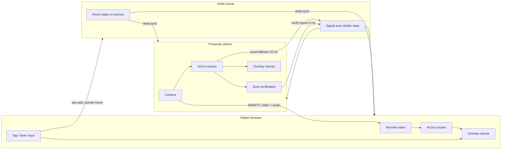

# RealityCheck Architecture

## Tracking

- The target layout (`shared/src/target-layout.ts`) is the single source for marker IDs, positions in mm, the test dot, and the verification zone. The PDF generator, tracker, and verifier all read it.
- Each frame is downscaled to 640 px wide and passed to js-aruco2 at ~18 Hz (100 ms interval if detection averages over 30 ms).
- Four 40 mm corner markers (IDs 10–13) give 16 point correspondences; a normalized least-squares DLT homography is fitted, and a marker whose leave-one-out reprojection exceeds 6 px is dropped.
- Corners pass through a One Euro filter. When markers disappear the last pose is held for 300 ms ("holding"), then the status becomes "lost".
- The 30 mm reference marker (ID 20) is not used for the pose while corners are visible; its predicted vs detected corners give the reported tracking error.

## Coordinate pipeline

1. Helper taps the overlay canvas (CSS pixels).
2. Canvas point → video pixel, undoing `object-fit: contain` and mirroring (`client/src/tracking/coords.ts`).
3. Video pixel → target mm through the inverse homography.
4. The annotation is stored in target mm in room state on the server and broadcast.
5. Every animation frame, each client projects target mm → video pixels → canvas with its own current homography.

If the helper's own tracker loses the target (e.g. compressed video), it uses the presenter's latest pose (`pose:fallback`, normalized to 0..1 video coordinates) for up to 600 ms.

## WebRTC

- The presenter always creates the offer; the helper always answers. Each attempt has a session id (`sid`) so late messages from an old attempt are ignored.
- ICE candidates are held until the local description has been sent, and queued on the receiver until the remote description is set.
- Presenter video is `sendonly`, capped at 2.5 Mbps with `contentHint = "detail"` and `maintain-resolution`, so markers stay sharp for the helper's tracker. Audio is two-way.
- The helper's Reconnect sends `request-offer`; the presenter rebuilds the connection. A failed connection retries after 1.5 s.
- ICE servers: Google STUN, plus TURN from `VITE_TURN_*` if set.

## Socket events

| Event | Direction | Purpose |
| --- | --- | --- |
| `room:join`, `room:leave` | client → server | join with role; server replies `state:sync` and broadcasts `room:peers` |
| `signal` | client → server → peer | offer / answer / candidate / request-offer |
| `ann:add`, `ann:update`, `ann:delete`, `ann:clear` | client → server → all | annotations (persisted in room) |
| `steps:set`, `steps:go`, `steps:complete` | client → server → all | step list and progress |
| `mode:set`, `verify:color` | client → server → all | guided/baseline, verification colour |
| `pointer:move`, `pose:fallback`, `verify:report` | client → others (volatile) | laser, presenter pose, verification result |
| `clock:ping` | client → server (ack) | server clock offset for sync-latency measurement |
