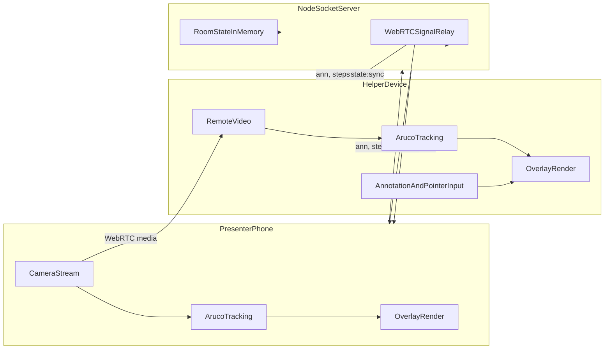

# RealityCheck Architecture

## Data model

- Annotation coordinates are persisted in target mm-space (`start`, optional `end`).
- Per-frame reprojection happens client-side from target space to current video frame.
- Room state sync includes:
  - annotations
  - steps and current step
  - live pointer state
  - fallback pose

## Coordinate pipeline

1. User tap/click on helper overlay canvas.
2. Canvas point to video pixel conversion using a shared `object-fit: contain` transform.
3. Video pixel mapped to target mm-space via inverse homography.
4. Annotation saved in room state in target mm-space.
5. Every frame, annotation mm point projected to current frame by homography and rendered on overlay.
