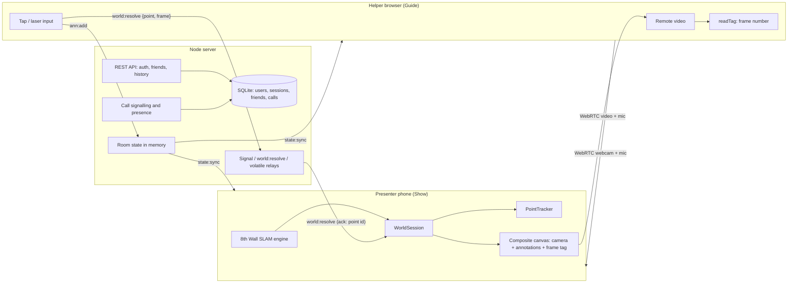

# RealityCheck Architecture

RealityCheck has three parts: a React client (the same app on phone and laptop), a Node server (REST API, Socket.IO, SQLite), and shared TypeScript types used by both. Calls connect two clients directly with WebRTC; the server only handles accounts, signalling, room state and small relays.

For the method-level walkthrough of a call, a tap and a pin, see [`code-guide.md`](./code-guide.md).

## Components

## Direct calling

- **Accounts:**
  - `POST /api/auth/register` and `/api/auth/login` return a session token. The client stores it in `localStorage` and sends it as `Authorization: Bearer …`.
  - Passwords are hashed with scrypt and a per-user salt (`server/src/db.ts`).
- **Presence:**
  - After connecting, the client's socket sends `auth:init {token}`. The server maps user ↔ sockets.
  - It broadcasts `friend:status` (online / in-call / offline) to the user's friends.
- **Ringing:**
  1. `call:start {receiverId, role}` creates a call record and marks both users busy.
  2. The server sends `call:ringing` back to the caller with their role, and `call:incoming` to each of the receiver's sockets with the opposite role.
  3. The call is marked missed after 45 s without an answer.
- **Answering:**
  - `call:accept` sends `call:accepted` to the caller and `call:connected` to the receiver.
  - Both clients then navigate to `/room/<callId>?role=<role>`, so the call ID is the room code.
  - `call:decline`, `call:cancel` and `call:end` update the record and notify the other side.
- **Roles:** the caller picks Show (presenter) or Guide (helper) on the home page. The choice defaults to Show on phones and is saved in `localStorage`.

## Rooms

- `room:join {code, role}`: the server normalises the code (uppercase alphanumerics, at most 12 characters) and keeps one in-memory room per code. It replies `state:sync` and broadcasts `room:peers`. An empty room is deleted after 2 hours.
- `RoomState` (`shared/src/types.ts`) holds:
  - `annotations`, `steps`, `currentStepId`;
  - guidance `mode` and verification colour;
  - `tracking` (`"world"` by default, or `"sheet"`);
  - `helperCamera`.
- Every change goes through the server and is broadcast to the whole room as `state:sync`.

## World tracking (default)

- **Engine:**
  - `WorldSession` (`client/src/world/session.ts`) loads the 8th Wall engine from `/external/xr/xr.js`. Vite serves it from `@8thwall/engine-binary` in development and copies it into `dist` on build.
  - It configures responsive scale with world points enabled.
  - Every frame the engine reports camera pose, intrinsics, tracking status and a sparse map of 3D feature points.
- **Outgoing video:**
  - The engine renders the camera into a WebGL canvas.
  - At 30 fps the session copies it into a 720-px-wide composite canvas, draws the annotations on top, and stamps a frame tag in the bottom-left corner.
  - `composite.captureStream(30)` plus the presenter's mic is the stream sent to the helper.
- **Taps:**
  1. The helper's tap becomes normalised 0..1 video coordinates.
  2. The helper's browser reads the frame tag from the frame on screen.
  3. It sends `world:resolve {point, frame}`. The server forwards it to the presenter socket with a 3 s ack timeout.
  4. The phone picks depth against the tracking state of that frame and creates a tracked point.
  5. The phone answers `{ok, id}`, and the helper stores an annotation with `world: {start, end}` point IDs.
- **Keeping points in place:**
  - Each point is anchored to nearby map points (it follows map refinements).
  - The point's image patch is re-found by template matching about 15 times a second, one point per pass.
- **Screens:** the phone draws annotations live from its own tracked points. The helper sees them burned into the video, so both screens always agree.
- **Laser:** the laser pointer is sent in video coordinates (`pointer:move`, volatile) and drawn only on the phone's screen.
- **Status:**
  - The phone sends `world:status` (starting / normal / limited / off) every second.
  - The helper's tracking chip shows it.
  - Points no annotation uses are pruned after 60 s.

## Printed-sheet mode (fallback and benchmark)

- The target layout (`shared/src/target-layout.ts`) is the single source for marker IDs, positions in mm, the test dot and the verification zone. The PDF generator, tracker and verifier all read it.
- **Detection:** each frame is downscaled to 640 px wide and passed to js-aruco2 at about 18 Hz. The interval stretches to 100 ms if detection averages over 30 ms.
- **Pose:**
  - Four 40 mm corner markers (IDs 10–13) give 16 point correspondences.
  - A normalised least-squares DLT homography is fitted. A marker whose leave-one-out reprojection exceeds 6 px is dropped.
  - Corners pass through a One Euro filter.
  - When markers disappear, the last pose is held for 300 ms ("holding"), then the status becomes "lost".
- **Reference marker:** the 30 mm reference marker (ID 20) is not used for the pose. Its predicted vs detected corners give the bench's tracking error.

### Sheet coordinate pipeline

1. The helper taps the overlay canvas (CSS pixels).
2. Canvas point → video pixel, undoing `object-fit: contain` and mirroring (`client/src/tracking/coords.ts`).
3. Video pixel → target mm through the inverse homography.
4. The annotation is stored in target mm in room state and broadcast.
5. Every animation frame, each client projects target mm → video pixels → canvas with its own current homography.

If the helper's own tracker loses the sheet (for example because of video compression), it uses the presenter's latest pose (`pose:fallback`, normalised video coordinates) for up to 600 ms.

## WebRTC

- **Who offers:**
  - The presenter always creates the offer and the helper answers.
  - Each attempt has a session ID (`sid`), so late messages from an old attempt are ignored.
- **ICE:** candidates are held until the local description has been sent, and queued on the receiver until the remote description is set.
- **Transceivers:**
  - Video and audio are both `sendrecv`. The helper's webcam (picture-in-picture on the phone) and mic are switched with `replaceTrack`, so turning them on needs no renegotiation.
  - Presenter video is capped at 2.5 Mbps, with `contentHint = "detail"` and `maintain-resolution`.
- **Recovery:** the helper's Reconnect sends `request-offer` and the presenter rebuilds the connection. A failed connection retries after 1.5 s.
- **ICE servers:** Google STUN, plus TURN from `VITE_TURN_*` if set.

## REST API

All routes except register and login need `Authorization: Bearer <token>`.

| Route | Purpose |
| --- | --- |
| `POST /api/auth/register`, `POST /api/auth/login` | create account / sign in, returns `{user, token}` |
| `GET /api/auth/me`, `POST /api/auth/logout` | current user / end session |
| `GET /api/users/search?q=` | find users by username |
| `GET /api/friends`, `DELETE /api/friends/:friendId` | friends with presence / remove a friend |
| `POST /api/friends/request`, `GET /api/friends/requests`, `POST /api/friends/respond` | send, list, accept or decline friend requests |
| `GET /api/calls/history` | recent calls |
| `GET /healthz` | health check |
| `POST /debug/report` | development only: writes `.debug/<role>.json` and `.jpg` |

## Socket events

| Event | Direction | Purpose |
| --- | --- | --- |
| `auth:init` | client → server | attach a signed-in user to the socket (presence, calls) |
| `friend:status` | server → friends | presence changes |
| `call:start`, `call:accept`, `call:decline`, `call:cancel`, `call:end` | client → server | call lifecycle |
| `call:ringing`, `call:incoming`, `call:accepted`, `call:connected`, `call:declined`, `call:cancelled`, `call:missed`, `call:ended`, `call:failed` | server → client | call lifecycle and errors |
| `room:join`, `room:leave` | client → server | join with role; server replies `state:sync` and broadcasts `room:peers` |
| `signal` | client → server → peer | offer / answer / candidate / request-offer |
| `ann:add`, `ann:update`, `ann:delete`, `ann:clear` | client → server → all | annotations (kept in room state) |
| `steps:set`, `steps:go`, `steps:complete` | client → server → all | step list and progress |
| `mode:set`, `verify:color`, `tracking:set`, `media:camera` | client → server → all | guided/baseline, verification colour, world/sheet tracking, helper webcam on/off |
| `world:resolve` | helper → server → presenter (with ack) | turn a tap on the video into a tracked point ID |
| `world:status` | presenter → helper (volatile) | world tracking health |
| `pointer:move`, `pose:fallback`, `verify:report` | client → others (volatile) | laser, presenter's sheet pose, verification result |
| `clock:ping` | client → server (ack) | server clock offset for sync-latency measurement |
