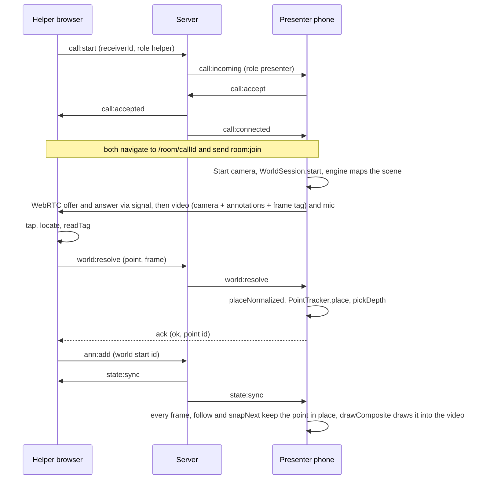

# Code Guide: Key Methods and App Flow

This page follows one call from sign-in to a pin that stays on a real object, naming the methods involved at each step. For the component diagram, REST routes and the full event list, see [`architecture.md`](./architecture.md).

Terms used throughout:

- **Presenter** ("Show"): the phone filming the object. It runs the tracking engine.
- **Helper** ("Guide"): any browser. It watches the presenter's video and places annotations.
- **Tracked point**: a 3D point on the presenter's phone, identified by an ID string, that an annotation hangs on in world mode.

## The whole flow at a glance

## 1. Signing in and calling

All of this lives in `client/src/state/facetime.ts` (zustand store `useFaceTimeStore`), `client/src/pages/Home.tsx`, and the call handlers in `server/src/index.ts`.

| Step | Method | What it does |
| --- | --- | --- |
| App start | `initAuth()` | Reads the saved token from `localStorage` and checks it with `GET /api/auth/me`. If it's valid, it opens the socket (which sends `auth:init`) and loads friends, requests and history. |
| Sign in | `login(username, password)` / `register(...)` | Calls the REST API. On success it stores the token, opens the socket, and loads friends, requests and history. |
| Server side | `createUser`, `authenticateUser`, `createSession`, `getSessionUser` (`server/src/db.ts`) | SQLite users and sessions. Passwords are hashed with scrypt and a random salt. |
| Friends | `sendFriendRequest`, `respondFriendRequest`, `removeFriend` | REST calls. Presence arrives as `friend:status` events. |
| Pick role | `chooseCallRole(role)` (Home) | Show = presenter, Guide = helper. Saved in `localStorage`; the default comes from `defaultCallRole()` (Show on phones). |
| Call | `startCall(friendId, role)` | Emits `call:start`. The server checks both users, records the call (`recordCallStart`), sets a 45 s ring timeout, and sends `call:ringing` / `call:incoming` with opposite roles. |
| Ring | `startRingbackTone()` / `startIncomingRingtone()` (`utils/sound.ts`) | Web Audio tones. `stopAllSounds()` stops them and suspends the audio context so it doesn't interfere with the camera. |
| Answer | `acceptIncomingCall()` | Emits `call:accept`. The server replies `call:accepted` (caller) and `call:connected` (receiver). Both set `navigationTarget` to `/room/<callId>?role=<role>`, and `App` navigates there. |
| Hang up | `endCall()` | Emits `call:end` and navigates home. |

## 2. Joining the room and connecting video

`client/src/pages/Room.tsx` is the room page for both roles. `client/src/state/room.ts` (`useRoomStore`) owns the room socket. `client/src/rtc/peer.ts` holds the WebRTC links.

| Step | Method | What it does |
| --- | --- | --- |
| Join | `useRoomStore.connect(roomCode, role)` | Opens a socket and emits `room:join`. Keeps `state` up to date from `state:sync`, `peers` from `room:peers`, and the server clock offset from `clock:ping`. |
| Server | `getRoom(code)`, `room:join` handler | One in-memory `RoomState` per code, with tracking defaulting to `"world"`. Every change is broadcast as `state:sync`. |
| Presenter link | `new PresenterLink(...)`, then `setStream(stream)`, then `connectTo(helperId)` | Once a helper is present and there is an outgoing stream, it creates the offer with `sendrecv` video and audio transceivers and caps video at 2.5 Mbps. It retries 1.5 s after a failure. |
| Helper link | `new HelperLink(...)`, `handleSignal(from, data)` | Answers the offer and shows the remote stream. `setMicTrack(track)` and `setCameraTrack(track)` swap the helper's mic and webcam in with `replaceTrack`, without renegotiating. |
| Signalling | `sendSignal(to, data)`, `onSignal(handler)` | Offer, answer and ICE candidates, relayed by the server's `signal` handler. Each attempt carries a session ID so stale messages are ignored. |
| Helper webcam | `toggleHelperCamera()` (Room) | `getUserMedia` for the front camera, then `setCameraTrack` and `setHelperCamera(true)`. The phone shows it picture-in-picture. |

What the presenter sends depends on the mode: `outgoing = presenterWorld ? worldStream : camera.stream`. In world mode the stream comes from `WorldStage`; in sheet mode it is the plain camera from `useCamera`.

## 3. Starting world tracking on the phone

`client/src/world/WorldStage.tsx` is the presenter's view in world mode, and `client/src/world/session.ts` (`WorldSession`) drives the engine.

| Step | Method | What it does |
| --- | --- | --- |
| Tap Start | `WorldStage.start()` | Creates a `WorldSession` with `drawComposite` (annotations) and `tagFrames: true`, and sets `isActive` (which points are worth re-finding). |
| Permissions | `WorldSession.start()` then `requestMotionPermission()` (`xr8.ts`) | Must run inside the tap: iOS only grants motion sensors from a user gesture, and SLAM needs them. Throws a clear message on laptops ("World tracking runs on phones"). |
| Load engine | `loadXR8()`, `XR8.loadChunk("slam")` | Loads `/external/xr/xr.js` once and waits for `xrloaded`. |
| Run | `WorldSession.run(XR8)` | Sizes the canvas, creates the 720-px composite canvas and a 360-px vision canvas, configures `XrController` (responsive scale, world points), adds the pipeline module, starts `composite.captureStream(30)`, then calls `XR8.run`. A 12 s timer reports an error if no camera frame arrives. |
| Every engine frame | `onUpdate` | Stores `reality` (pose, intrinsics, tracking status, map points) and calls `tracker.follow(reality)`. |
| Every rendered frame | `onRender` | About every 66 ms, `tracker.snapNext(...)` re-finds one point. At 30 fps it copies the camera into the composite, calls `drawComposite`, then `remember(frame, reality)` and `drawTag(...)`. |
| Go live | `onPhase("running")`, then `publish(session)` | Only now asks for the mic (asking earlier can stop iOS from starting the camera), then hands `[composite video, mic]` to the room via `onStream`. |
| Health | 1 s interval in `WorldStage` | Sends `world:status`, prunes unused points older than 60 s, and counts annotations whose points no longer exist. |

## 4. A tap becomes a pin (world mode)

This is the core of the app. The helper only knows a 2D spot on a video; the phone turns it into a 3D point.

**On the helper (`Room.tsx`):**

1. `onPointerDown` / `onPointerUp`: a press that moves less than 12 px counts as a tap and calls `placeAnnotation(point)`, which routes to `placeWorldAnnotation(point)` in world mode.
2. `locate(point)` converts canvas pixels to normalised 0..1 video coordinates, undoing `object-fit: contain` (`computeVideoBox`, `canvasToVideoPoint` in `tracking/coords.ts`).
3. `readTag(video)` (`world/frameTag.ts`) reads the frame number from the strip in the bottom-left of the frame currently on screen:
   - the strip is 2 reference cells (white, black), 12 frame-number bits and an even-parity bit;
   - it returns `null` if the strip is unreadable.
4. `useRoomStore.resolveWorldPoint({ point, frame })` emits `world:resolve` with a 4 s timeout. The server forwards it to the presenter socket with a 3 s ack timeout.

**On the presenter:**

5. The handler registered with `setWorldResolver(...)` (in `WorldStage`) calls `session.placeNormalized(id, point, frame)`.
6. `placeNormalized` looks up the remembered tracking state of that frame (`history`, the last 120 frames, about 4 s) and calls `PointTracker.place(id, reality, tap, width, height, { seen, hitTest })`.
7. `PointTracker.place` (`world/anchoring.ts`):
   - computes depth with `pickDepth(seen ?? reality, ...)`;
   - falls back to the engine's `hitTest` on the current frame if that fails;
   - stores the point and its anchors;
   - grabs the vision image and cuts a 31×31 template around the point with `makeTemplate` (only if the patch has texture).
8. `pickDepth(reality, tap, width, height)` (`world/xr8.ts`) chooses between two strategies:
   - **Textured spot:** `pickByNearbyPoints` takes the map points that project within 40 px of the tap. If there are at least 5 and their depth spread is at most 15%, it uses their median depth along the tap's ray. The points within ±15% of that depth become the pin's anchors.
   - **Plain surface:** `pickByLocalPlane` gathers points within 70, then 110, then 170 px until it has 6. It fits a plane with RANSAC (80 triplets), refines the inliers by least squares (`fitDepthPlane`: depth = aX + bY + c in camera space), and intersects the tap's ray: depth = c / (1 − a·u − b·v). The result is rejected if the depth is under half or over twice the local median.
   - If the few points right at the tap are not on the fitted plane, the tap is on something in front of the surface, so the median result wins.
9. The ack `{ ok: true, id }` returns to the helper. Failures come back as a readable reason, such as "That spot isn't mapped yet - ask the presenter to move the phone slowly around it."

**Back on the helper:**

10. For an arrow, the first tap's point ID is held in `pendingWorldRef` until the second tap. Then `addAnnotation({ ..., world: { start, end } })` sends `ann:add`. The server stores it and broadcasts `state:sync`.

**Drawing:**

11. The phone's `drawAnnotations(ctx, width, height, project)` looks up each annotation's tracked points and projects them with `projectWorldPoint`. It is used twice:
    - on the phone's own screen overlay, every animation frame;
    - into the outgoing composite, via `drawComposite`. That is how the helper sees the pins.

## 5. Keeping a pin in place

Two mechanisms run on the phone for every tracked point (`world/anchoring.ts`, `world/patch.ts`):

- **Follow the map:** `PointTracker.follow(reality)` runs every engine frame. `resolveAnchoredPosition(anchors, worldPoints)` takes the per-axis median of (anchor point + stored offset) over the anchors still in the map, so the pin moves with the engine's refinements.
- **Re-find the patch:** `PointTracker.snapNext(reality, now, active)` runs about 15 times a second, one point per call (round-robin), and calls the private `snap`:
  1. It projects the point and a nearby reference direction into the vision image. It picks the stored view closest in distance and roll, and predicts the scale from the depth ratio and the roll from the reference direction's on-screen angle.
  2. `buildPyramid(gray)` makes half-resolution levels, so zoomed-in views don't alias.
  3. `matchAcrossScales(pyramid, template, x, y, angle, scale, 60)` runs a normalised cross-correlation search (`matchTemplate`), hill-climbing the scale in steps of 1.19×. It returns the score, the margin over the second-best peak, and the shift.
  4. The correction is accepted only if:
     - the score is at least 0.8;
     - the margin is at least 0.1;
     - two consecutive matches agree within 4 px.

     The point then moves 60% of the way to the match and is re-anchored.
  5. Very confident matches (score at least 0.85, margin at least 0.15) seen at a noticeably different distance (1.35×) or roll (0.4 rad) are saved as extra views, up to 8. Later searches use the most similar view.

`describeSnap(point)` and `serializePoint(point)` (`world/diagnostics.tsx`) summarise this for the debug HUD and reports.

## 6. Printed-sheet mode

When `state.tracking === "sheet"`, the presenter sends its plain camera and both sides track the sheet themselves.

| Step | Method | What it does |
| --- | --- | --- |
| Detect | `useTracking({ videoRef, ... })`, then `FrameDetector.detect(video)` (`tracking/detector.ts`) | Downscales to 640 px and runs js-aruco2 at about 18 Hz. |
| Pose | `TargetTracker.update(detections, time)` (`tracking/tracker.ts`) | Builds marker-corner ↔ millimetre correspondences, fits `computeHomography` (normalised DLT), drops outlier markers, smooths corners with `OneEuroFilter`, and holds the pose for 300 ms before reporting "lost". |
| Tap | `placeAnnotation(point)`, `locate(point)` | Canvas → video pixel → target mm via `invertHomography` and `projectPoint`. The annotation stores mm. |
| Draw | `Overlay` (`overlay/Overlay.tsx`) | Projects mm → video → canvas with the current homography every frame, using `drawPin`, `drawArrow`, `drawTextMarker`, `drawLabel` and `drawPointer`. |
| Fallback | `sendPoseFallback` / `pose:fallback` | If the helper loses the sheet in compressed video, it borrows the presenter's pose for up to 600 ms. |
| Verify | `measureZone(...)` (`tracking/verify.ts`) | Colour check inside the printed zone, reported as `verify:report`. |
| Bench | `StatsRecorder`, `appendTrial`, `downloadCsv` (`state/bench.ts`) | Benchmark metrics and CSV export. |

## Module reference

### `client/src/world/`

| File | Key exports | Role |
| --- | --- | --- |
| `session.ts` | `WorldSession`: `start`, `stop`, `recenter`, `placeNormalized`, `project` | Engine lifecycle, composite video, frame history, vision grabs |
| `anchoring.ts` | `PointTracker`: `place`, `follow`, `snapNext`, `remove`, `clear`; `describeSnap` | Tracked points: placement, anchoring, patch snapping, views |
| `xr8.ts` | `loadXR8`, `requestMotionPermission`, `worldToCamera`, `cameraToWorld`, `unproject`, `projectWorldPoint`, `pickDepth`, `pickByNearbyPoints`, `pickByLocalPlane`, `resolveAnchoredPosition` | Engine types and loading; projection and depth math |
| `patch.ts` | `toGray`, `buildPyramid`, `makeTemplate`, `matchTemplate`, `matchAcrossScales` | Template matching (normalised cross-correlation) |
| `frameTag.ts` | `drawTag`, `readTag`, `tagCells`, `decodeCells` | Frame numbers in the video |
| `WorldStage.tsx` | `WorldStage` | Presenter UI in world mode; tap resolver; status and debug reporting |
| `fakeXr8.ts` | `loadFakeXR8` | Dev-only fake engine (`?fakeworld=1`) |
| `diagnostics.tsx` | `WorldCredit`, `trackingLabel`, `summarizeReality`, `serializePoint`, `countVideoFrames` | Attribution and debug helpers |
| `WorldSpike.tsx` | `WorldSpike` | `/world-spike` test page |

### `client/src/state/`

| File | Key exports | Role |
| --- | --- | --- |
| `room.ts` | `useRoomStore`: `connect`, `disconnect`, `addAnnotation`, `updateAnnotation`, `deleteAnnotation`, `setSteps`, `goToStep`, `setTracking`, `setHelperCamera`, `resolveWorldPoint`, `setWorldResolver`, `sendWorldStatus`, `sendPointer`, `serverNow` | Room socket and shared room state |
| `facetime.ts` | `useFaceTimeStore`: `initAuth`, `login`, `register`, `logout`, `loadFriends`, `sendFriendRequest`, `respondFriendRequest`, `startCall`, `acceptIncomingCall`, `declineIncomingCall`, `cancelOutgoingCall`, `endCall` | Accounts, friends, presence, calls |
| `bench.ts` | `StatsRecorder`, `loadTrials`, `appendTrial`, `trialsToCsv`, `downloadCsv` | Benchmark recording |

### `client/src/rtc/peer.ts`

| Class | Methods | Role |
| --- | --- | --- |
| `PresenterLink` | `setStream`, `connectTo`, `handleSignal`, `close` | Offers; sends video and mic; receives the helper's mic and webcam |
| `HelperLink` | `handleSignal`, `requestOffer`, `setMicTrack`, `setCameraTrack`, `close` | Answers; receives video; sends mic and webcam |

### `client/src/tracking/` (printed-sheet mode)

| File | Key exports | Role |
| --- | --- | --- |
| `detector.ts` | `loadDetector`, `FrameDetector.detect` | ArUco detection |
| `tracker.ts` | `TargetTracker.update`, `reset` | Pose from markers, smoothing, lost state |
| `homography.ts` | `computeHomography`, `invertHomography`, `projectPoint`, `scaleHomography`, `reprojectionRms` | Homography math |
| `filter.ts` | `OneEuroFilter` | Jitter smoothing |
| `coords.ts` | `computeVideoBox`, `canvasToVideoPoint`, `videoToCanvasPoint` | Screen ↔ video coordinates |
| `verify.ts` | `measureZone`, `COLOR_PRESETS` | Colour-zone verification |
| `useTracking.ts` | `useTracking` | React hook running detection on a video |

### `server/src/`

| File | Key parts | Role |
| --- | --- | --- |
| `index.ts` | REST routes, `authMiddleware`, call handlers (`call:*`), `getRoom`, `normalizeCode`, room and relay handlers, `world:resolve` relay with ack | HTTP and Socket.IO server |
| `db.ts` | `createUser`, `authenticateUser`, `createSession`, `getSessionUser`, `getFriends`, `sendFriendRequest`, `respondToFriendRequest`, `recordCallStart`, `recordCallStatus`, `getCallHistory` | SQLite persistence (`data/realitycheck.db`) |

### `shared/src/`

| File | Role |
| --- | --- |
| `types.ts` | Every shared type: `RoomState`, `Annotation` (with `world` point IDs), `TrackingMode`, `WorldResolveRequest` / `WorldResolveResult`, `SignalMessage`, `User`, `Friend`, `CallRecord`, … |
| `target-layout.ts` | Printed-sheet layout: marker IDs and positions, test dot, verification zone |

## Tests and debugging

- `npm test` runs five suites:

  | Suite | What it checks |
  | --- | --- |
  | `scripts/test-tracking.ts` | sheet pose accuracy on rendered images |
  | `scripts/test-world-math.ts` | projection, depth picking, plane fit, frame tags |
  | `scripts/test-patch.ts` | template matching under drift, roll, zoom, flat patches |
  | `scripts/test-server.ts` | room sync and relays, including `world:resolve` |
  | `scripts/test-facetime.ts` | accounts, friends, calls and roles |

- **Fake engine:** `?fakeworld=1` on a presenter room URL (development only) replaces the tracking engine with a synthetic textured wall, so a full world-mode call can run in two browser tabs.
- **Synthetic camera:** `?synthetic=1` renders a moving printed sheet for sheet mode.
- **Show debug:** in development, both sides post diagnostics to `POST /debug/report` every 2 s, written to `.debug/presenter.json` / `.debug/helper.json` with a frame snapshot. The presenter report includes start-up phase, camera status, tracking state and every tracked point; the helper report includes the tap log with frame numbers.
